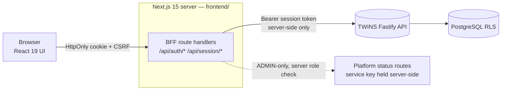
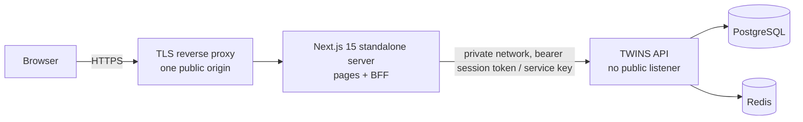

# TWINS Frontend — Architecture (Stage 09)

Status: **PROPOSED — corrected after the Stage 09.0 final review.** Nothing in this document is implemented. No `frontend/` app and no `packages/api-contracts` code exists yet. Mockups in `docs/frontend/mockups/` are synthetic and fixture-labelled.

Companion documents: [design-system](design-system.md) · [screen-map](screen-map.md) · [api-integration-map](api-integration-map.md) · [permissions-and-navigation](permissions-and-navigation.md) · [testing-and-accessibility](testing-and-accessibility.md) · [stage09-implementation-plan](stage09-implementation-plan.md)

## 1. Principles

1. **The frontend is never a security boundary.** Every authorisation, ownership, risk and audit decision is made by the backend (forced owner-only RLS, permission checks, 404-for-foreign-resources). The frontend hides what a user cannot use; it never grants anything.
2. **Paper Trading is the only operational mode.** Assisted Live and Controlled Auto render as disabled/planned (G-48). Nothing in the UI implies a live broker, live market data, hosted AI or external provider is operational unless verified.
3. **Honest availability.** Where the backend has no capability, the screen shows `UNAVAILABLE` ("planned"), never a fake control. All outcome data is fixture-backed today (G-30) and is labelled `FIXTURE`.
4. **Display-only money, no calculation.** The backend sends money as decimal strings (orders, fills, positions, `permittedSize.maxLossAtStop`, portfolio facts) *and* as numbers (candidate prices, `permittedSize.lots/quantity/sizeMultiplier`). The frontend formats both for display and performs **no financial or risk calculation** (no totals, P&L, R-multiples, sizing, exposure, validity). Anything the backend does not supply — including unrealised P&L, mark prices and live balances, which do not exist — is shown UNAVAILABLE.
5. **Session only in the browser.** The shared service key never reaches browser code. TRADER traffic uses session-authenticated, owner-scoped endpoints only. **ADMIN has no private permissions** (`ROLE_PERMS`): ADMIN never receives private trader screens, only shared intelligence, platform status and own-account pages.

## 2. Repository strategy (Decision 1, Option C)

```
/Users/sara/twins
├── apps/ services/ packages/ adapters/      ← backend npm workspaces (unchanged)
├── packages/api-contracts/                  ← NEW: browser-safe contracts (Decision 2)
├── frontend/                                ← NEW: standalone Next.js app, own package.json + lockfile
└── docs/frontend/                           ← this documentation set
/Users/sara/twins-frontend                   ← old frontend: UNTOUCHED reference, read-only
```

- `frontend/` is **outside** the workspace globs (`apps/*`, `services/*`, `packages/*`, `adapters/*`); it installs independently (`npm ci --prefix frontend`) and cannot be hoisted into backend installs.
- `apps/web` (existing options viewer) is neither replaced nor renamed.
- The old repo is read only; assets are ported file by file after review (see §9).
- `packages/api-contracts` *is* inside the `packages/*` glob (backend tests import it) but has **zero runtime dependencies** and no backend-internal imports; `frontend/` consumes it by relative path alias (`@twins/api-contracts` → `../packages/api-contracts/src`), compiled by Next via `transpilePackages`/tsconfig paths. Rationale: no publish step, one source of truth, drift tests see both sides.
- Trade-off accepted: two lockfiles. Benefit: backend CI cannot be destabilised by frontend dependency churn.

## 3. System context



- The browser holds one cookie: `__Host-twins_session` (HttpOnly, Secure, SameSite=Strict, Path=/). It contains the opaque `tws_…` token; JavaScript can never read it.
- A second, readable CSRF cookie (double-submit) accompanies every state-changing call.
- The BFF translates cookie → `Authorization: Bearer`. The backend has no CORS; the browser never talks to it directly.

## 4. Technology (Decision 5)

| Concern | Choice | Note |
|---|---|---|
| Framework | Next.js **15**, App Router, React **19** | Do **not** move to Next 16 |
| Language | TypeScript strict | shared tsconfig rules mirror backend |
| Styling | Tailwind CSS **3.4** + CSS variable tokens | Do **not** move to Tailwind 4 |
| Server state | TanStack Query | polling only; backend has no SSE/WebSocket |
| Tables | TanStack Table | virtualisation only if a table exceeds ~500 rows |
| Forms | React Hook Form + Zod | Zod schemas also validate BFF inputs and API responses at the edge |
| Charts | Recharts (existing, compatible) | decorative-free, tabular alternatives always present |
| Tests | Vitest, Playwright, axe (existing tooling) | see testing doc |
| Client state | URL + React state | **No Zustand** unless a documented requirement proves it insufficient |

Version pins are to be chosen at implementation against the npm registry and recorded in `frontend/package.json`; the exact versions observed during this audit are listed in the implementation plan.

## 5. Application layers

```mermaid
flowchart TB
  UI[Screens & components<br/>no fetch, no business rules] --> Hooks[Query hooks<br/>one per endpoint]
  Hooks --> Client[Typed API client<br/>fetch → /api/session/*]
  Client --> Contracts[(@twins/api-contracts<br/>types, endpoint catalogue,<br/>permissions, error codes)]
  Hooks --> State[Data-state mapper<br/>→ LOADING READY EMPTY STALE<br/>ERROR DENIED UNAVAILABLE PARTIAL]
  UI --> DS[Design system<br/>tokens · primitives · domain badges]
  UI --> Fmt[Formatters<br/>money · qty · time (display only)]
```

Directory sketch (`frontend/src`): `app/` (routes, route groups `(trader)`, `(admin)`, `(auth)`), `bff/` (server-only helpers), `api/` (client + hooks), `state/` (data-state model, availability registry), `ui/` (primitives), `domain/` (badges, ladders, meters), `format/`, `screens/`. Rule enforced by lint: `ui/` and `domain/` may not import `api/`; `screens/` may not call `fetch`.

## 6. The eight data states

Every data region resolves to exactly one state, produced centrally by `state/` so screens never invent their own:

| State | Meaning | Visual | Trigger |
|---|---|---|---|
| LOADING | request in flight, nothing cached | skeleton, `aria-busy` | first fetch |
| READY | fresh data present | normal | 2xx + data + CURRENT |
| EMPTY | valid response, zero items | explanatory empty panel with next step | 2xx + `[]` |
| STALE | data present but older than its freshness limit, or refetch failed with cache | banner + STALE chip, values stay | server freshness flag or client age check |
| ERROR | request failed (5xx/network/validation of response) | error panel, retry | non-2xx other than below |
| DENIED | 401, or 403 on a shared route; on a **private** route the backend answers **404** for both "not permitted" and "someone else's" — shown as NOT FOUND, and for ADMIN as "not available to administrators" | lock panel; 401 ends the session | auth failure |
| UNAVAILABLE | backend capability does not exist or feature disabled | dashed "NOT AVAILABLE" panel, reason, "planned" | availability registry / 503 `DEPENDENCY_UNAVAILABLE` / `EXECUTION_DISABLED` |
| PARTIAL | some sections loaded, others failed or missing | per-section states + summary banner | multi-source screens |

Availability registry (ported idea from old `src/api/registry.ts`, rewritten): a typed table `capability → {status: AVAILABLE | PLANNED | ADMIN_ONLY, backendRef, gap}` which is the *only* place that says a capability is not there. Its entries are rewritten against Stage 04–08 reality (the old registry is stale).

## 7. Backend-for-frontend (BFF) design

Reused from the reviewed old implementation (session cookie, CSRF, GET allow-list, 401 clears cookie, per-user cache purge, `no-store`) with these **hardenings** applied in the port:

1. **Fail-closed same-origin**: state-changing requests require `Origin` (or `Sec-Fetch-Site: same-origin`); a missing header is refusal, not pass.
2. **`__Host-` cookie prefix** (Secure, Path=/, no Domain); development uses an explicit non-prefixed name behind an env switch.
3. **Exact token regex** `^tws_[A-Za-z0-9_-]{43}$` validated before any use; malformed → treated as no session.
4. **CSRF rotation** on login and session refresh; compared in constant time.
5. **Per-route Zod schemas** for every request body and query forwarded; unknown fields rejected (the backend also rejects them).
6. **Allow-listed relay only**: method + path regex + query keys. Anything else → 404 from the BFF without contacting the backend. Allow-list is generated from `@twins/api-contracts` so it cannot drift.
7. **Idempotency:** `idempotencyKey` is a **request-body field** (`^[A-Za-z0-9_.:-]{8,128}$`) on approve, reject, watch and unwatch (cancel has none and requires a reason). The client generates it when the confirmation dialog opens and reuses it on retry.
8. **Security headers + CSP** (`default-src 'self'`, no inline scripts via nonce, `frame-ancestors 'none'`, `Referrer-Policy: same-origin`, `Cache-Control: no-store` on authenticated responses). The old app set none.
9. **No legacy shared-key proxy.** The old `/api/twins/[...path]` route is **not ported**. Platform (service-key) reads for ADMIN live in a separate, ADMIN-only BFF module that checks the session role *server-side* before attaching the key. The key is read from server env and never serialised.
10. **Login throttling.** The backend locks a login key after 5 failures per **email** (`failureKey(email)`), which lets anyone lock a known user out. The BFF adds a per-IP and per-IP+email throttle on `/api/auth/login` (and the reverse proxy a coarse per-IP limit) with neutral responses, so one source cannot exhaust an account's attempts; client IP comes from the trusted proxy header only. Residual: a distributed attacker can still trigger lockouts (see risk register).
11. Responses are validated against contract Zod schemas at the BFF edge in development/CI (drift detection); in production a failed validation maps to `ERROR` without leaking payload details.

Interim accepted residual risk (documented, not hidden; **a BFF role check is not equivalent to backend-enforced authorization**): the legacy platform routes authenticate by shared key only, so "ADMIN-only" for those is enforced by the BFF role check. A compromised BFF process could therefore read platform status. These routes expose system status, not private trader data. Closing it needs session/role-protected backend equivalents (separate approval).

## 8. Contracts package (Decision 2)

`packages/api-contracts` contains **only**: request/response TypeScript types, the endpoint catalogue (method, path, permission, query keys, body keys, response schema name), permission constants, error-code constants + HTTP map, and shared enum exports (decision states/outcomes, order states, position states, modes, data sources, freshness).

Explicit exclusions: any runtime import of `@twins/outcomes` (it pulls backend code; types and `ANALYTICS_ENDPOINTS` are **re-declared**), any import of `@twins/database`, `@twins/planning`, `@twins/execution`, `@twins/decision`, `@twins/outcomes` (runtime), `@twins/auth`, Node built-ins, or `pg`. `@twins/types` is browser-safe and may be re-exported.

Guards (tests, no behaviour change):
- **Import guard**: scans `frontend/` and `packages/api-contracts/` for forbidden specifiers and Node built-ins.
- **Catalogue vs server**: enumerates the Fastify route table (user/session routes) and asserts every catalogue entry exists with the same method, path and permission, and that every session route is either in the catalogue or on an explicit exclusion list.
- **Response drift**: for each fixture-backed backend response in existing tests, parse with the contract Zod schema; extra or missing fields fail.
- **Constants parity**: permission lists, `ROLE_PERMS`, both error-code HTTP maps (platform and approval) and enums equal the backend definitions.

Seeds (verified): `docs/api/openapi-session.json` (session intelligence read routes, guarded by `tests/unit/api/openapiSession.test.ts`) and `ANALYTICS_ENDPOINTS`/`ResponseEnvelope` in `packages/outcomes/src/contracts.ts`. G-51 restated: those two have machine-readable descriptions; the `userApi` routes (accounts, capital, risk, portfolio, decisions, approvals, execution) do not. Stage 09.1 adds that and proves parity (see the testing doc). The role→permission table (`ROLE_PERMS`) is mirrored as constants for UX gating only, with a parity test.

Implementation note (09.1): the package is `packages/api-contracts` as specified; decision-outcome names are deliberately not mirrored (outcome is a displayed string; see [contracts-verification](contracts-verification.md) §2).

## 9. Assets from the old frontend (review before reuse)

| Asset | Plan |
|---|---|
| Session BFF helpers, login/logout/me/relay routes | port with §7 hardenings; re-review line by line |
| `tests/session.test.ts`, `routes.test.ts`, `e2e/session.spec.ts`, `e2e/stubBackend.mjs`, axe harness | port and extend; stub backend regenerated from contracts |
| Eight-state model | port, extended with PARTIAL semantics |
| Demo fixtures + bundle-leak check | port; fixtures are `FIXTURE`-labelled and compiled out of production builds |
| `/api/twins` shared-key proxy, availability registry contents, "read-only/approve in Telegram" copy | **do not port** (stale or unsafe) |

## 10. CI integration

New workflow job `frontend` in `.github/workflows/ci.yml`: Node 22, `npm ci --prefix frontend`, typecheck, lint, unit (Vitest), contract tests, `next build`, Playwright (stub backend), axe, bundle-leak check. It is added to `ci-gate.needs` **only after it has been green on a trial branch** and is path-filtered so backend-only changes still require it to *succeed or be skipped-as-unchanged* (gate treats `skipped` from the path filter as pass). Backend jobs are untouched; the frontend job never starts Postgres/Redis. Contract-drift tests run in the existing backend `unit` job (they only need the backend source).

## 11. Observability & operations (frontend)

No third-party analytics or error SaaS (private platform, ~10 users). Errors log to the server console in the BFF with correlation IDs (no tokens, no financial values, no payloads). A `/api/health` BFF route reports build id only.

## 12. Hosting and deployment architecture (recommended; provider UNDECIDED)



- **Single origin:** the browser talks only to the Next.js app (pages and `/api/*`); no CORS is needed and the API is **not** reachable from the internet.
- **Next.js `output: "standalone"`** run as a Node process (container or service) behind a TLS-terminating reverse proxy that sets `X-Forwarded-*`, HSTS, and a coarse per-IP rate limit.
- **Private network** between the Next server and the API (loopback, private VLAN or internal Docker network); the shared service key and API base URL are server-side environment secrets, never in the bundle.
- A CSP with per-request nonces makes pages dynamically rendered; acceptable at ~10 users.
- Decisions that depend on the host (all **OPEN**): provider and plan; domain and certificate issuance/renewal; final cookie name and attributes (`__Host-` needs HTTPS, `Path=/`, no `Domain`); trusted-proxy configuration (client IP for throttling); secret storage; process supervision, logs and backup; how frontend CI deploys; whether API and Next share a machine. No deployment is part of Stage 09.

## 13. Open items

See [stage09-implementation-plan](stage09-implementation-plan.md#risks--open-questions).
