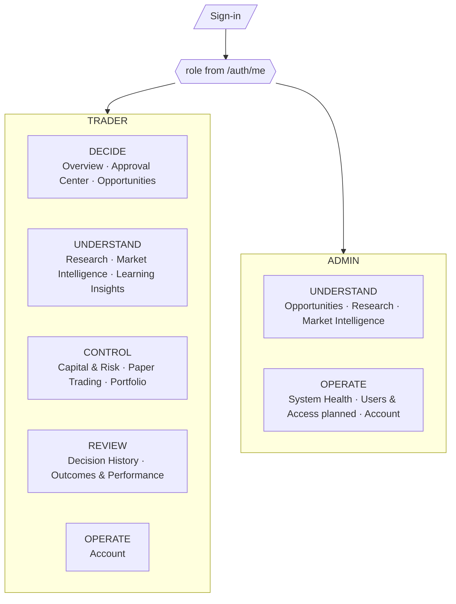

# TWINS Frontend — Permissions and Navigation

Status: PROPOSED (corrected after the Stage 09.0 final review). **The backend is authoritative.** Everything here is user experience: it decides what to *show*, never what is *allowed*. Every request is re-checked server-side (permission, role, ownership via RLS).

Evidence: `packages/types/src/platform/auth.ts` (`SHARED_PERMISSIONS`, `PRIVATE_PERMISSIONS`, `ADMIN_PERMISSIONS`, `ROLE_PERMS`, `hasPermission`, `authorize`, `ownerScope`), `apps/api/src/userApi.ts` (`who()`), `apps/api/src/{opportunity,research,telegramIntel,intelligence}Api.ts`, `packages/auth/src/service.ts`.

## 1. Roles and permissions (verified)

`GET /auth/me` returns `{ user: { id, email, displayName, role, isActive } }` — a single `role` (`PublicUser`, `service.ts:14`). It does **not** return a permission list.

| Group | Permissions |
|---|---|
| Shared (no owner) | signals:read, research:read, market:read, strategies:read, opportunities:read, channels:read |
| Private (owner-scoped) | capital:read/write, risk-policy:read/write, risk:read, broker:read/write, orders:read/write, positions:read, trades:read, decisions:read, decisions:watch, decisions:approve, analytics:read, settings:write |
| Admin | users:manage, audit:read, channels:manage, system:read |

`ROLE_PERMS`: **TRADER = shared + private. ADMIN = shared + admin.** An ADMIN holds **no private permission**.

Consequences (verified in `authorize()`):
- A private route called without the permission, or on another user's resource, returns **404 NOT_FOUND**, never 403 (existence is not leaked). So an ADMIN calling any private route gets 404.
- A *shared* route called without its permission returns 403 FORBIDDEN.
- Therefore "403 ⇒ DENIED" is not sufficient: for private routes a 404 can also mean "not permitted".

**Frontend permission mirror (decision 4).** Because permissions are a static function of role, `packages/api-contracts` (Stage 09.1) will mirror `ROLE_PERMS` as constants, with a parity test against the backend table. The frontend uses it **only to decide what to render**. No backend change to `/auth/me`. It is never an authorization check.

## 2. Experience by role

| | TRADER | ADMIN |
|---|---|---|
| Accent / chip | brass, "TRADER" | steel-blue, "ADMIN" + "Administration console" |
| Landing | Overview | Platform overview (System Health) |
| Workspaces visible | DECIDE, UNDERSTAND, CONTROL, REVIEW, OPERATE (Account) | UNDERSTAND (shared intelligence only), OPERATE |
| Private screens (approvals, decisions, capital & risk, paper trading, portfolio, learning/analytics, history, outcomes) | yes (own data) | **never rendered; no nav item; direct URL shows "Not available to administrators"** |
| Shared intelligence (opportunities, research, market) | yes | yes |
| Platform status routes (World B) | never | System Health via server-side-checked BFF module |
| Own account (password, theme) | yes | yes |

An ADMIN is not a super-trader: no admin page renders any user's decisions, capital, positions, outcomes or analytics, and there is no "view as user".

## 3. Navigation

Mockups implement exactly this (`mockups/assets` + 01–07): TRADER rail has 5 workspaces; ADMIN rail has Platform overview, UNDERSTAND (shared screens) and OPERATE. Desktop: rail; phones: bottom bar (TRADER: five workspaces; ADMIN: Platform, Understand, Operate).

## 4. Route table and guards

| Route | TRADER | ADMIN |
|---|---|---|
| `/login` | unauthenticated only | same |
| `/` Overview, `/approvals`, `/insights`, `/capital-risk`, `/paper`, `/portfolio`, `/decisions[/:id]`, `/performance` | yes | **blocked: "Not available to administrators"** |
| `/opportunities[/:id]`, `/research/[id]`, `/market` | yes | yes (shared data only; no decision link) |
| `/account` | yes | yes |
| `/admin/system`, `/admin/users` | **blocked (DENIED page)** | yes |

Guards, all required: (1) **server component/middleware**: cookie presence; role from a server-side `/auth/me` for role-restricted routes (middleware alone is never sufficient); (2) **BFF**: role check before any World B call, and may short-circuit private relays for ADMIN as a UX optimisation (the backend would answer 404 anyway); (3) **backend**: authoritative for everything.

## 5. Feature visibility matrix

| Feature | TRADER | ADMIN | Basis |
|---|---|---|---|
| Read approvals / decisions | yes | no | decisions:read (private) |
| Approve / reject / cancel | yes, own, `action.available` | no | decisions:approve |
| Watch / unwatch | yes, own | no | **decisions:watch** (separate; a private bookmark, `grantsApproval:false`) |
| Request paper execution | not available | not available | no HTTP route (gap) |
| Capital / risk edit | not available | not available | no write routes (gap) |
| Analytics / outcomes | yes | no | analytics:read (private) |
| Shared intelligence | yes | yes | shared permissions |
| System health | no | yes | World B + server role check |
| User management | no | planned (writes exist; no list/audit route) | users:manage, audit:read have no browser routes |
| Live / Assisted Live / Controlled Auto | shown disabled | same | G-48 |

## 6. Account selection

Every private screen except the approvals queue and execution lists is account-scoped. After sign-in the shell calls `GET /accounts` (returns `{accounts:[{id,name,tradingMode,baseCurrency,isActive}]}`). If one account: select automatically. If several: an account switcher in the topbar. The selected id lives in the URL (`?account=<uuid>`) and is passed as `accountId` where the backend **requires** it: `/capital/profile`, `/risk/policy`, `/portfolio` (all validated with `uuid(q["accountId"])`; foreign or unknown id → 404). It is optional for `/decisions`; analytics accept it (whether it is required is **to be confirmed by the 09.1 route-table test**). `/execution/orders` and `/execution/positions` have no `accountId` filter. No accounts → EMPTY with an explanation, not an error. ADMIN has no account selector.

## 7. Session lifecycle in the UI

Backend: sliding 8 h idle, 7 d max (`DEFAULT_AUTH_CONFIG`), revocation on logout, password change (other devices), role change, deactivation. UI: poll `/auth/me` (60 s); on 401 clear all client caches, show "Session ended", return to sign-in preserving the intended **path** only. Logout purges the query cache and per-user storage and broadcasts to other tabs. A role change revokes sessions server-side, so the next call returns 401.

## 8. Copy rules

DENIED (shared route 403 / role-blocked page): "You don't have access to this." For ADMIN on a private page: "Trader areas belong to each trader and are not available to administrators." Not-found (404): neutral "Not found" — never reveals whether something exists for someone else. Planned capability: say what is missing and who does it today; every such text maps to a registry entry with a gap reference.

## 9. Acceptance criteria

1. Playwright: an ADMIN session never renders a private screen or nav item; direct URL shows the blocked panel; the BFF/backend call for a private route yields 404 and the UI maps it correctly.
2. TRADER cannot reach `/admin/*`; the TRADER bundle contains no World B paths or service-key strings.
3. Role comes from `/auth/me`, never from client storage; mirror constants equal `ROLE_PERMS` (parity test).
4. 404 on a private route renders "not found/not available", not a generic error; 403 on a shared route renders DENIED.
5. No nav item exists for a capability marked not available except as a labelled planned item (`Users & Access`, `Market Intelligence` partial).
