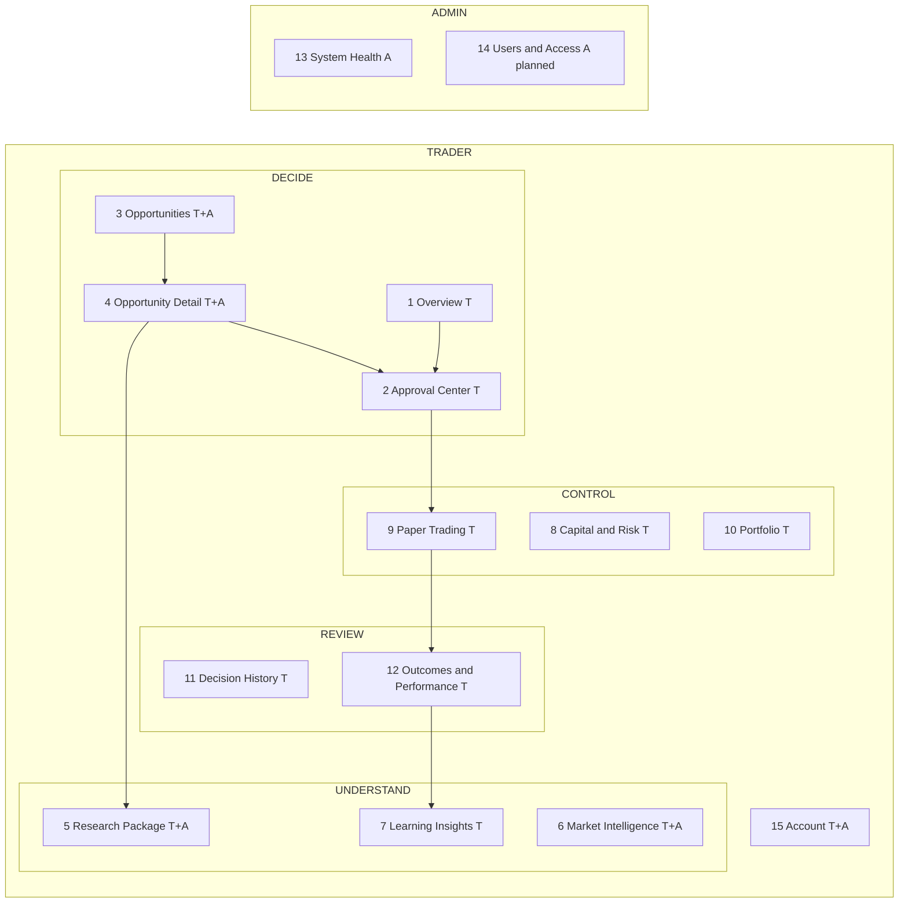

# TWINS Frontend — Screen Map

Status: PROPOSED (corrected after the Stage 09.0 final review). Fifteen screens plus sign-in, in five workspaces. Endpoints refer to [api-integration-map](api-integration-map.md); permissions and role rules to [permissions-and-navigation](permissions-and-navigation.md). Every screen supports the eight states (LOADING, READY, EMPTY, STALE, ERROR, DENIED, UNAVAILABLE, PARTIAL); only screen-specific behaviour is listed.

**Role legend:** T = TRADER only · T+A = TRADER and ADMIN (shared data) · A = ADMIN only. **ADMIN holds no private permission**, so every T-only screen is never rendered for ADMIN (no nav item; direct URL shows "Not available to administrators"; the backend would answer 404).

**Global data rules.** The frontend displays what the backend returns and performs **no financial or risk calculation** (no totals, P&L, R-multiples, sizing, exposure, validity). Anything not supplied is UNAVAILABLE. There is **no unrealised P&L, mark price or live balance** in any backend response. Money is a decimal string or a number depending on the field (api-integration-map §6); both are display-only. Fixture-sourced data always carries a `FIXTURE` badge; a `LIVE` badge is specified but never rendered (analytics return `liveStatus:"UNAVAILABLE"`).

## 1. Navigation (matches the mockups)

## 2. User journeys

1. **Morning desk (T):** sign in → account auto-selected (or choose in the topbar) → Overview → Approval Center → open a pending decision → read ladder, `permittedSize`, reasons → Approve (confirmation dialog, key generated) → server status shown → Paper Trading shows the unavailable-execution notice (execution is requested by the operator CLI today).
2. **Choose account (T, several accounts):** topbar switcher → URL `?account=` → capital, risk, portfolio and analytics views reload for that account; no accounts → EMPTY with guidance.
3. **Research a candidate (T+A):** Opportunities → Detail → Research Package (agents, contradictions, evidence). For ADMIN, no decision link appears.
4. **After the close (T):** Paper Trading → Outcomes & Performance → Learning Insights.
5. **Platform (A):** sign in → Platform overview (System Health) → Users & Access (planned) → shared intelligence screens if needed.
6. **Denied paths:** TRADER opens `/admin/*` → DENIED page. ADMIN opens a private URL → "Not available to administrators". Neither is blank or a redirect loop.
7. **Locked out (any):** repeated failed sign-ins → neutral "Too many attempts, try again later" (backend FORBIDDEN, keyed per email); the BFF adds its own per-IP throttle.

## 3. Screen specifications

Format: roles · purpose · data/API · actions (permission) · screen-specific states · acceptance.

### DECIDE

**1. Overview (T)** — *mockup 01.* Purpose: one-glance desk state. Data: `/approvals` (counts, pending list), `/execution/positions?status=OPEN`, `/risk/controls`, `/analytics/overview` (freshness chip, cumulative result chart from analytics, FIXTURE). The open-positions table shows instrument, position status, quantity, average entry and **stop-loss** (all backend fields); **no unrealised P&L**. Actions: links only. States: each tile independent → PARTIAL; EMPTY "nothing needs a decision". Acceptance: counts equal list lengths; every figure has its own state and FIXTURE badge when applicable.

**2. Approval Center (T)** — *mockup 02.* Data: `/approvals`, `/decisions/:id`, `/decisions/:id/comparables`. Actions: **Approve**, **Reject**, **Cancel** (`decisions:approve`); **Watch/Unwatch** (`decisions:watch`). Request rules: `idempotencyKey` in the body (created when the dialog opens, reused on retry); reason optional for approve and reject (1–300), **required 5–300 for cancel** (cancel has no key). Approval error states (api-integration-map §2): NOT_PENDING, NOT_QUALIFIED, EXPIRED, REVALIDATION_FAILED (state INVALIDATED, `reasons` = failed check names), ALREADY_ACTIONED, NOT_PERMITTED. Buttons follow the server `action` and `expired`. Paper execution: UNAVAILABLE panel ("Approving records your decision; it does not place an order"). Acceptance: no client-side risk/validity logic; double click sends one request; reasons shown verbatim as names.

**3. Opportunities (T+A)** — Data: `/opportunities/candidates`, `/opportunities/scans` (`opportunities:read`; shared). Filters in URL. Candidate prices are numbers (display only). States: EMPTY "no candidates in the latest scan". For ADMIN the same screen without any account or decision context.

**4. Opportunity Detail (T+A)** — *mockup 03.* Data: `/opportunities/candidates/:id`, `/research/candidates/:id/package`; for TRADER, `/decisions` (state/accountId/limit only) matched client-side on `candidateId` among loaded rows and labelled as such. No order-creating control; UNAVAILABLE panel explains approval is the only browser action. ADMIN sees evidence and research only.

### UNDERSTAND

**5. Research Package (T+A)** — Data: `/research/packages/:id`, `/research/agents` (`research:read`). Shows agent verdicts, evidence refs, risk flags, contradictions, role coverage, `grantsApproval:false`. PARTIAL when agents did not complete. Plain text only.

**6. Market Intelligence (T+A, partial)** — Data (session, shared): `/intelligence/channels[/:id]`, `/intelligence/claims[/:id]`, `/intelligence/claims/:id/historical-matches`, `/intelligence/candidates`, `/intelligence/pipeline`, `/intelligence/channels/:id/performance`, `/intelligence/playbooks[/:id]`, `/intelligence/archive/channels`. **Not used (World B, shared key):** `/intelligence/source`, `POST /intelligence/estimate`, `/risk/decisions/:id/intelligence`. Market regime and live quotes: UNAVAILABLE (G-16/G-20). Acceptance: no panel implies live data or hosted AI.

**7. Learning Insights (T)** — *mockup 05.* Data: the 11 `/analytics/*` endpoints (`analytics:read`). Shows the envelope (`dataset:"PAPER"`, `liveStatus:"UNAVAILABLE"`, `notice`) and `snapshot`/`freshness` (id, `asOf`, evidence/input hash short form, CURRENT/STALE, `staleReason`). Dataset toggle on overview only (default VALIDATED). Learning is advisory; nothing here changes risk or execution. STALE banner when freshness is STALE. Every chart has a table view. Backend `liveStatus` and `notice` shown verbatim.

### CONTROL

**8. Capital & Risk (T)** — Data: `/accounts`, `/capital/profile?accountId`, `/risk/policy?accountId`, `/risk/controls`. **Read-only** (no write routes). Edit affordances replaced by an UNAVAILABLE panel ("changed by the operator for now"). Account selection required.

**9. Paper Trading (T)** — *mockup 04.* Data: `/execution/orders`, `/execution/orders/:id/fills`, `/execution/positions`, `/execution/positions/:id/events`. Positions table: instrument, position status, latest order status, quantity, average entry, **stop-loss**, **realised P&L** (backend strings). No mark, no unrealised P&L. Order, position and decision statuses use different shapes. Actions: none; "Request execution" and manual exit/stop are UNAVAILABLE (no route; platform manages positions by rules). Responsive: table in a focusable scroll region.

**10. Portfolio (T)** — Data: `/portfolio?accountId` → `facts`. Shows exactly: open positions, **allocated notional** (at entry price; margin not modelled), realised P&L, and capital fields (total, available, unallocated) where non-null; null → UNAVAILABLE. Shows the backend `notes[]` verbatim ("no live portfolio source is connected"). No unrealised P&L.

### REVIEW

**11. Decision History (T)** — Data: `/decisions` (`state`, `accountId`, `limit`), `/decisions/:id`. Limit-only → "Load more". Any other filter is client-side over loaded rows and says so.

**12. Outcomes & Performance (T)** — Data: `/analytics/outcomes`, `/analytics/decisions`, `/analytics/strategies`. All outcomes are fixture-backed (G-30) and badged. Values as returned; no recomputation.

### OPERATE

**13. System Health (A)** — *mockup 06 (Platform overview).* Data via the ADMIN-only BFF module (World B): `/health/status`, `/system/config`, `/agents/status`, `/intake/status`. Fields in the mockup are illustrative; exact fields are confirmed from `statusSurface.ts` at implementation. No private trader data. Events/audit: PLANNED panel (no route). Never visible to TRADER. Residual risk: BFF-only role enforcement (api-integration-map §4).

**14. Users & Access (A, planned)** — Backend operations exist (`POST /admin/users`, `/admin/users/:id/role`, `/admin/users/:id/active`) but there is no user-list, audit viewer or `system:read` route and writes are out of Stage 09 scope. A planned-state page listing what exists vs missing; **no working form** (the mockup shows a PLANNED panel).

**15. Account (T+A)** — Data: `/auth/me`, `POST /auth/change-password` (revokes other sessions), `POST /auth/logout`. Theme preference (localStorage in try/catch). Password never logged; fields cleared after submit.

**Sign-in** — `POST /auth/login` via the BFF. Lockout (5 failures per email key) → FORBIDDEN "too many attempts"; wrong credentials → 401 UNAUTHENTICATED "invalid credentials" (VERIFIED by test); the UI shows one neutral message for both. No register link (closed by default).

## 4. Screen–role–data matrix

| # | Screen | T | A | Needs accountId | Data source |
|---|---|---|---|---|---|
| 1 | Overview | ✓ | – | partly | session private |
| 2 | Approval Center | ✓ | – | – | session private |
| 3 | Opportunities | ✓ | ✓ | – | session shared |
| 4 | Opportunity Detail | ✓ | ✓ | – | session shared (+ private decisions for T) |
| 5 | Research Package | ✓ | ✓ | – | session shared |
| 6 | Market Intelligence | ✓ | ✓ | – | session shared; regime UNAVAILABLE |
| 7 | Learning Insights | ✓ | – | optional | session private (analytics) |
| 8 | Capital & Risk | ✓ | – | **required** | session private, read-only |
| 9 | Paper Trading | ✓ | – | – | session private |
| 10 | Portfolio | ✓ | – | **required** | session private |
| 11 | Decision History | ✓ | – | optional | session private |
| 12 | Outcomes & Performance | ✓ | – | optional | session private |
| 13 | System Health | – | ✓ | – | World B via BFF (ADMIN) |
| 14 | Users & Access | – | ✓ | – | planned |
| 15 | Account | ✓ | ✓ | – | session |

## 5. Global acceptance criteria

1. All eight states rendered per screen in Playwright against the stub.
2. Keyboard-only operation; axe 0 violations in both themes at 1440/820/390.
3. Route allow-list enforced; TRADER bundle has no World B strings; ADMIN never renders a private screen (test).
4. No arithmetic on money; no figure displayed that is not a backend field or explicitly a labelled illustration in a mockup.
5. Every capability claim is backed by a registry entry or a labelled mockup; FIXTURE visible wherever data is fixture-backed.
