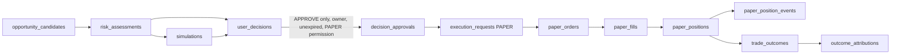

# Database architecture and entity relationships (Stage 02)

PostgreSQL, forward-only Drizzle migrations 0000-0041, SQL hand-appended by `scripts/product/append-00NN.py`. 120 tables. Money is `numeric` (exact), time is `timestamptz`.

## Ownership model
- `users` owns everything private. `accounts(id, user_id)` is the ownership anchor: every account-owned table has a composite foreign key `(account_id, user_id) -> accounts(id, user_id)`, so a row can never name another user's account.
- Row-level security (`FORCE`, owner-only policy on `user_id = twins.user_id`) covers every table with a `user_id`, plus the legacy account-owned tables through their account. `twins.user_id` is bound per transaction by `withUser`. Exception: `user_sessions` (see ADR-018).
- Runtime role (`app-role.sql`): read/append only; no UPDATE/DELETE on append-only evidence; `users` read-only except password hash and display name; privileged changes only through SECURITY DEFINER doors (`twins_create_user`, `twins_set_user_role`, `twins_set_user_active`, `twins_create_user_decision`, `twins_record_decision_approval`, ...).
- ADMIN holds no private permission: the pure model (`packages/types/src/platform/auth.ts`) and every route return NOT_FOUND for private data.

## Domain areas and where they live
| Area | Tables (examples) |
|---|---|
| Identity | users, user_sessions, auth_login_failures |
| Accounts, broker | accounts, broker_connections (credential_ref = `secretref:...`) |
| Capital and risk policy | user_capital_profiles, user_risk_policies, user_execution_permissions (live modes forced off), risk_control_events |
| Telegram | telegram_sources, telegram_messages, options_claims (append-only, hash-chained) |
| Research, market | research_packages, agent_* , market_* observations, regimes |
| Opportunities | opportunity_scans, opportunity_candidates (+ events) |
| Assessment | confidence_assessments, risk_assessments, simulations |
| Decisions | user_decisions, user_decision_events, decision_approvals, decision_invalidations |
| Execution (paper) | execution_requests, paper_orders, paper_fills, paper_positions, paper_position_events, trade_outcomes |
| Learning, analytics | outcome_attributions, learning_insights, learning_job_runs, confidence_calibration_runs |
| Audit | audit_events, audit_chain_heads, system_control_events, ai_usage_records |

## The trading lifecycle (one owner at every step)

Guards (all in the database): a QUALIFIED decision needs a VALID stop-loss validation, a non-BLOCKED risk assessment of the same user, account and candidate, and a research package; only `workflow_state` of a decision changes; an approval is one-time (unique per decision), by the owner, only for a QUALIFIED PENDING unexpired decision on an account with PAPER enabled; an order needs an ELIGIBLE PAPER request for the same decision and account and an APPROVED decision, and an entry cannot exceed the permitted size; a fill cannot exceed the remaining quantity or beat a limit price; a position needs a filled entry order and an APPROVED decision, its stop can only tighten, and a closed position is final; live execution modes are refused by constraint.
Derived checks: `paper_position_fill_check` (quantity = entry fills - exit fills) and `account_portfolio_facts`.

## What is ready and what is not
Ready: the schema, ownership, isolation, lifecycle and precision above, proved by `tests/integration/database/stage02.test.ts` once CI runs.
Not integrated (Stage 10 and later): any live market data, broker, portfolio or margin source; real fills; notification delivery.
