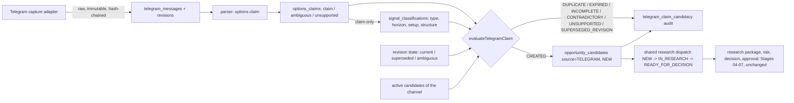

# Telegram intelligence: architecture, evidence flow and the candidate pipeline (Stage 03)

## Flow

Independent candidates (source INDEPENDENT, scan-originated) use the same table and dispatch and are distinguishable by `source`, `claim_id` / `scan_id` and a database check.

## Evidence and provenance
Each candidate carries: source TELEGRAM; channel id, message id, origin message id, revision state, message and capture timestamps, capture method and delay, parser, classifier and policy versions (`provenance`); evidence references (`evidence`: claim id, message id); the parsed values; `missing_information`; `validation_status` (UNVERIFIED until a contract master or price check exists); `candidate_version`; a deterministic `thesis` of what the source claims. No raw message text is stored by the pipeline; the claim and the raw message remain in their own immutable tables, which carry the chain-of-custody.

## Reading it (session-protected, read-only, shared permissions)
`GET /intelligence/channels`, `/intelligence/channels/:id` (health, capture timeliness, claim and candidate counts), `/intelligence/claims`, `/intelligence/claims/:id` (parsed fields, classification codes, candidacy decision, candidate state), `/intelligence/candidates`, `/intelligence/pipeline`.

## Safeguards that already existed and are reused
Signal classification (`signal-classifier-v1`), revision classification, the Stage 03 historical import, scorecards, playbook versioning with the 30-resolved-out-of-sample activation rule and drift monitoring: unchanged. They need resolved real outcomes (G-30) to say anything about a channel's reliability, so channel reliability is reported NOT_AVAILABLE and no small sample is presented as a verdict.

## Not in this stage
Production Telegram connection and any real-message accuracy measurement (needs owner approval and data, M02-15); contract-master verification, live prices and hosted AI (Stage 10); research agents (Stage 04); UI for these screens (Stage 09 wiring).
